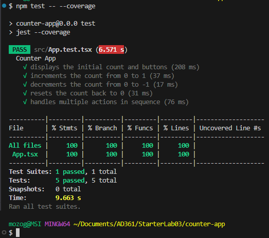
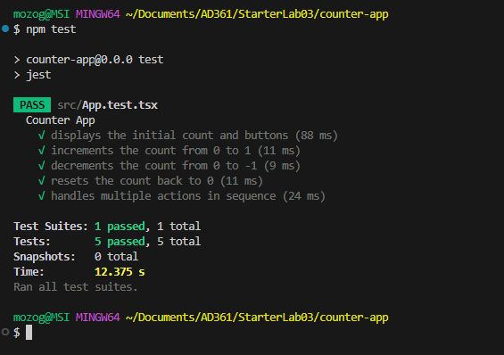

# React + TypeScript + Vite

This template provides a minimal setup to get React working in Vite with HMR and some ESLint rules.

Currently, two official plugins are available:

- [@vitejs/plugin-react](https://github.com/vitejs/vite-plugin-react/blob/main/packages/plugin-react) uses [Oxc](https://oxc.rs)
- [@vitejs/plugin-react-swc](https://github.com/vitejs/vite-plugin-react/blob/main/packages/plugin-react-swc) uses [SWC](https://swc.rs/)

## React Compiler

The React Compiler is not enabled on this template because of its impact on dev & build performances. To add it, see [this documentation](https://react.dev/learn/react-compiler/installation).

## Expanding the ESLint configuration

If you are developing a production application, we recommend updating the configuration to enable type-aware lint rules:

```js
export default defineConfig([
  globalIgnores(["dist"]),
  {
    files: ["**/*.{ts,tsx}"],
    extends: [
      // Other configs...

      // Remove tseslint.configs.recommended and replace with this
      tseslint.configs.recommendedTypeChecked,
      // Alternatively, use this for stricter rules
      tseslint.configs.strictTypeChecked,
      // Optionally, add this for stylistic rules
      tseslint.configs.stylisticTypeChecked,

      // Other configs...
    ],
    languageOptions: {
      parserOptions: {
        project: ["./tsconfig.node.json", "./tsconfig.app.json"],
        tsconfigRootDir: import.meta.dirname,
      },
      // other options...
    },
  },
]);
```

You can also install [eslint-plugin-react-x](https://npmx.dev/package/eslint-plugin-react-x) and [eslint-plugin-react-dom](https://npmx.dev/package/eslint-plugin-react-dom) for React-specific lint rules:

```js
// eslint.config.js
import reactX from "eslint-plugin-react-x";
import reactDom from "eslint-plugin-react-dom";

export default defineConfig([
  globalIgnores(["dist"]),
  {
    files: ["**/*.{ts,tsx}"],
    extends: [
      // Other configs...
      // Enable lint rules for React
      reactX.configs["recommended-typescript"],
      // Enable lint rules for React DOM
      reactDom.configs.recommended,
    ],
    languageOptions: {
      parserOptions: {
        project: ["./tsconfig.node.json", "./tsconfig.app.json"],
        tsconfigRootDir: import.meta.dirname,
      },
      // other options...
    },
  },
]);
```

---

# AD361 Lab 03 – Exploratory and White-Box Testing

## Step 1: Exploratory Testing

### Testing Charter

My goal was to test how the counter application responds to different button interactions. I wanted to make sure Increment, Decrement, and Reset worked correctly, including when the buttons were used multiple times or in different sequences.

### Exploratory Test Results

I started each test with the count at zero.

| Action                                 | Expected Result | Actual Result | Pass/Fail |
| -------------------------------------- | --------------- | ------------- | --------- |
| Increment once                         | Count: 1        | Count: 1      | Pass      |
| Decrement once                         | Count: -1       | Count: -1     | Pass      |
| Increment five times                   | Count: 5        | Count: 5      | Pass      |
| Increment three times, then Reset      | Count: 0        | Count: 0      | Pass      |
| Decrement twice, Reset, then Increment | Count: 1        | Count: 1      | Pass      |

All five exploratory tests passed. I didn't notice any unexpected behavior while testing the buttons.

## Step 2: Source Code Examination

After completing exploratory testing, I examined `App.tsx`.

The counter starts at zero using React's `useState`:

```tsx
const [count, setCount] = useState(0);
```

There are three statements that change the count.

| Statement             | User Action     | Result       |
| --------------------- | --------------- | ------------ |
| `setCount(count + 1)` | Click Increment | Adds 1       |
| `setCount(count - 1)` | Click Decrement | Subtracts 1  |
| `setCount(0)`         | Click Reset     | Returns to 0 |

The component doesn't contain any `if`, `else`, or `switch` statements, so there are no conditional branches. There also aren't any loops.

Because of this, branch coverage and loop coverage aren't particularly useful for this component. Statement coverage is more relevant because I can check that each button's code actually runs.

## Steps 3–6: Automated Testing

I created `src/App.test.tsx` using Jest and React Testing Library.

The test suite contains five tests:

1. Verify the starting count is zero and all three buttons appear.
2. Verify Increment changes the count from 0 to 1.
3. Verify Decrement changes the count from 0 to -1.
4. Verify Reset returns the count to zero after incrementing.
5. Verify multiple button interactions work correctly in sequence.

The tests use `render`, `screen`, `fireEvent`, and Jest assertions.

## Step 7: Test Results

I ran the automated tests using:

```bash
npm test
```

All five tests passed.



## Step 8: Code Coverage

I ran the coverage report using:

```bash
npm test -- --coverage
```

### Coverage Results for App.tsx

| Coverage Type | Percentage |
| ------------- | ---------- |
| Statements    | 100%       |
| Branches      | 100%       |
| Functions     | 100%       |
| Lines         | 100%       |



The tests executed all three statements that change the count, along with the component's initial rendering. No statements in `App.tsx` were left untested.

Branch coverage reports 100%, but this component doesn't actually have any conditional branches. There aren't any different decision paths to cover.

I don't think 100% coverage automatically means the application works perfectly. It shows that the tests executed the code, but it doesn't guarantee that every possible issue has been caught.

## Step 9: Exploratory vs. White-Box Testing

During exploratory testing, I tried different combinations of button clicks, including decrementing below zero, resetting, and incrementing again. This helped me see how the application behaved during normal use.

After examining the source code, I focused on testing each statement that changes the count. One specific test was changing the count before clicking Reset to verify that `setCount(0)` returned it to zero.

Looking at the code helped me understand exactly what needed to be tested and made my automated tests more specific.

The limitation of exploratory testing is that I might miss something happening behind the scenes because I can't see the code. White-box testing helps with that, but it can also miss usability problems or unexpected behavior that someone might discover just by using the application.

Both approaches were useful because they looked at the application from different perspectives.
